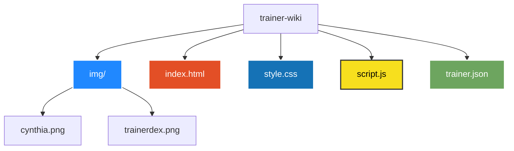

# Trainerdex 🔴


> Uma enciclopédia interativa em formato de **Pokédex (TrainerDex)** construída com HTML5, CSS3 e JavaScript puro, que apresenta treinadores icônicos da franquia Pokémon, suas regiões, títulos e equipes completas.

---

## 💻 Sobre o Projeto

O projeto **Trainerdex** (`trainer-wiki`) foi desenvolvido para praticar manipulação dinâmica do DOM, consumo assíncrono de dados estruturados em JSON (`Fetch API`) e posicionamento responsivo sobre interfaces gráficas complexas.

Na **v1.0.0**, a aplicação reúne um catálogo de **12 treinadores clássicos e campeões** (Cynthia, Ash, Diantha, Misty, Brock, Red, Blue, Steven, Lance, Iris, Leon e Giovanni), integrando sprites locais e externos (Pokémon Showdown) com os sprites oficiais dos Pokémon via **[PokéAPI](https://pokeapi.co/)**.

---

## ⚙️ Funcionalidades

- **Interface Estilo Pokédex (TrainerDex):** Layout construído sobre o shell clássico da Pokédex com coordenadas relativas (`%`) e unidades responsivas (`vh` / `vw`).
- **Navegação Dupla (D-Pad & Teclado):** Permite alternar entre os treinadores clicando diretamente nas setas gravadas na cruz preta da Pokédex ou utilizando as teclas `←` e `→` do teclado.
- **Carregamento Dinâmico via JSON:** Consome os perfis dos treinadores a partir de `trainer.json` utilizando `fetch` com `async/await`.
- **Renderização Automática de Equipes:** Gera dinamicamente os 6 sprites da equipe de cada treinador a partir dos IDs da PokéAPI com renderização pixelada (`image-rendering: pixelated`).
- **Feedback Visual nos Controles:** Animação de pulso sutil (`pulseHint`) nas setas do D-Pad para indicar interatividade imediata ao usuário.

---

## 🏗️ Arquitetura

O projeto segue uma separação clara entre estrutura visual, estilização espacial e camada de dados:

- **Apresentação (`index.html` + `style.css`):** Define os visores da TrainerDex, o grid 3x2 da equipe Pokémon e o mapeamento espacial dos botões sobre o D-Pad.
- **Lógica e Consumo (`script.js`):** Controla o estado de navegação (`currentIndex`), escuta eventos de clique e teclado e atualiza o DOM em tempo real.
- **Base de Dados (`trainer.json`):** Armazena os objetos de cada treinador (`id`, `nome`, `regiao`, `cargo`, `sprite` e array `time` com os IDs na PokéAPI).

---

## 📊 Estrutura de Fluxo do Sistema

Abaixo está o caminho dos dados entre o arquivo JSON e a interface da TrainerDex durante a navegação:

| Etapa | Origem / Arquivo | Ação / Exemplo de Retorno |
| :--- | :--- | :--- |
| **1. Inicialização** | `script.js` (`chamarTreinador`) | Executa `fetch('./trainer.json')` ao carregar a página |
| **2. Carregamento** | `trainer.json` | Retorna o array com os 12 objetos de treinadores |
| **3. Renderização** | `script.js` (`renderTreinador`) | Preenche sprite, nome (`CYNTHIA`), região (`SINNOH`) e cargo (`CAMPEÃ`) |
| **4. Montagem do Time** | `trainer.time.forEach(...)` | Cria 6 tags `` apontando para os sprites da PokéAPI |
| **5. Interação** | D-Pad (`click`) ou Teclado (`keydown`) | Atualiza `currentIndex` em loop circular (`% treinadores.length`) |
| **6. Atualização Visual** | `index.html` + `style.css` | Exibe o próximo treinador e sua equipe nos visores da Pokédex |

---

## 🛠️ Tecnologias Utilizadas

- **HTML5:** Estruturação semântica dos visores, sprites e botões interativos.
- **CSS3:**
  - Posicionamento absoluto preciso (`position: absolute` + `transform: translate(-50%, -50%)`).
  - **CSS Grid** (`grid-template-columns: repeat(3, 1fr)`) para alinhamento da equipe Pokémon.
  - Tipografia fluida com `clamp()` e animações `@keyframes`.
- **JavaScript (ES6+):**
  - Requisições assíncronas com `fetch` e `async/await`.
  - Manipulação do DOM (`getElementById`, `createElement`, `appendChild`).
  - Eventos de mouse (`click`) e teclado (`ArrowLeft`, `ArrowRight`).
- **PokéAPI & Pokémon Showdown:** Fontes dos sprites oficiais dos Pokémon e treinadores.

---

## 🚀 Como Executar o Projeto Localmente

### Pré-requisitos
- Navegador web moderno (Chrome, Firefox, Edge ou Safari).
- [VS Code](https://code.visualstudio.com/) com a extensão **Live Server** (necessário para o `fetch('./trainer.json')` funcionar sem bloqueio de CORS).
- [Git](https://git-scm.com) instalado na máquina.

### ☕ Passo a Passo

1. **Clone este repositório:**
   ```bash
   git clone https://github.com/AliceSilva2012/trainer-wiki.git
   ```

2. **Acesse a pasta do projeto:**
   ```bash
   cd trainer-wiki
   ```

3. **Inicie um servidor local:**
   - Abra a pasta no VS Code, clique com o botão direito em `index.html` e selecione **Open with Live Server**.

---

## 📁 Estrutura de Arquivos


